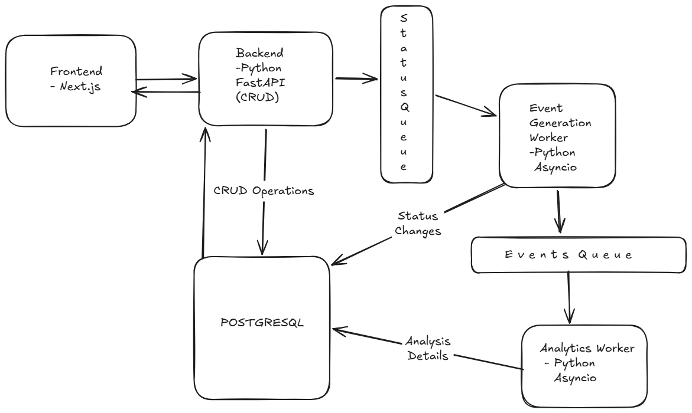

# GSEAnalytiX

A Python-powered backend application for managing projects and the device usage.
Generates synthetic device usage events and it is used for analyzing total runtime and cost.

## Tech Stack
Backend
-   Python, FastAPI and Pydantic
-   PostgreSQL and SQLAlchemy
-   Redis and asyncio workers
-   Pytest and FastAPI TestClient
-   Docker 

Frontend
-   Next.js
-   TailwindCSS
-   Axios

# Architecture



# Database Schema


# Flow Diagram


## REST API

The responses below are examples.
### Projects

#### 1) POST - Create Project

```text
http://localhost:8000/api/projects
```

**Request Body:**

```json
{
    "project_name": "GSE"
}
```

**Output:**

```json
{
    "message": "Project Created Successfully!",
    "data": {
        "project_id": "77addd4b-291d-468d-a5a5-95224d6287de",
        "project_name": "GSE",
        "created_at": "2026-11-26T21:37:02.883120"
    }
}
```

#### 2) GET - Get all projects

```text
http://localhost:8000/api/projects
```

**Output:**

```json
{
    "message": "Projects Retrieved Successfully!",
    "data": [
        {
            "project_id": "77addd4b-291d-468d-a5a5-95224d6287de",
            "project_name": "GSE",
            "created_at": "2026-11-26T21:37:02.883120"
        }
    ]
}
```

#### 3) GET - Get project by ID

```text
http://localhost:8000/api/projects/77addd4b-291d-468d-a5a5-95224d6287de
```

**Output:**

```json
{
    "message": "Project Retrieved Successfully based on project_id",
    "data": {
        "project_id": "77addd4b-291d-468d-a5a5-95224d6287de",
        "project_name": "GSE",
        "created_at": "2026-11-26T21:37:02.883120"
    }
}
```

#### 4) PUT - Update Project

```text
http://localhost:8000/api/projects/77addd4b-291d-468d-a5a5-95224d6287de
```

**Request Body:**

```json
{
    "project_name": "GSE Updated"
}
```

**Output:**

```json
{
    "message": "Project Updated Successfully!",
    "data": {
        "project_id": "77addd4b-291d-468d-a5a5-95224d6287de",
        "project_name": "GSE Updated",
        "created_at": "2026-11-26T21:37:02.883120"
    }
}
```

#### 5) DELETE - Delete Project

```text
http://localhost:8000/api/projects/77addd4b-291d-468d-a5a5-95224d6287de
```

**Output:**

```json
{
    "message": "Project Deleted Successfully!",
    "data": null
}
```

### Devices

#### 1) POST - Create Device

```text
http://localhost:8000/api/projects/77addd4b-291d-468d-a5a5-95224d6287de/devices
```

**Request Body:**

```json
{
    "device_name": "Generator",
    "tariff_per_kwh": "0.30"
}
```

**Output:**

```json
{
    "message": "Device Created Successfully!",
    "data": {
        "device_id": "67f8b8e0-bc87-4835-82fd-ff474c7f8f0d",
        "project_id": "77addd4b-291d-468d-a5a5-95224d6287de",
        "device_name": "Generator",
        "tariff_per_kwh": "0.30",
        "status": "created",
        "created_at": "2026-11-26T21:38:00"
    }
}
```

#### 2) GET - Get all devices in a project

```text
http://localhost:8000/api/projects/77addd4b-291d-468d-a5a5-95224d6287de/devices
```

**Output:**

```json
{
    "message": "Devices Retrieved Successfully!",
    "data": [
        {
            "device_id": "67f8b8e0-bc87-4835-82fd-ff474c7f8f0d",
            "project_id": "77addd4b-291d-468d-a5a5-95224d6287de",
            "device_name": "Generator",
            "tariff_per_kwh": "0.30",
            "status": "created",
            "created_at": "2026-11-26T21:38:00"
        }
    ]
}
```

#### 3) GET - Get device by ID

```text
http://localhost:8000/api/projects/77addd4b-291d-468d-a5a5-95224d6287de/devices/67f8b8e0-bc87-4835-82fd-ff474c7f8f0d
```

**Output:**

```json
{
    "message": "Device Retrieved Successfully!",
    "data": {
        "device_id": "67f8b8e0-bc87-4835-82fd-ff474c7f8f0d",
        "project_id": "77addd4b-291d-468d-a5a5-95224d6287de",
        "device_name": "Generator",
        "tariff_per_kwh": "0.30",
        "status": "created",
        "created_at": "2026-11-26T21:38:00"
    }
}
```

#### 4) PUT - Update Device

```text
http://localhost:8000/api/projects/77addd4b-291d-468d-a5a5-95224d6287de/devices/67f8b8e0-bc87-4835-82fd-ff474c7f8f0d
```

**Request Body:**

```json
{
    "device_name": "Generator Updated",
    "tariff_per_kwh": "0.45"
}
```

**Output:**

```json
{
    "message": "Device Updated Successfully!",
    "data": {
        "device_id": "67f8b8e0-bc87-4835-82fd-ff474c7f8f0d",
        "project_id": "77addd4b-291d-468d-a5a5-95224d6287de",
        "device_name": "Generator Updated",
        "tariff_per_kwh": "0.45",
        "status": "created",
        "created_at": "2026-11-26T21:38:00"
    }
}
```

#### 5) DELETE - Delete Device

```text
http://localhost:8000/api/projects/77addd4b-291d-468d-a5a5-95224d6287de/devices/67f8b8e0-bc87-4835-82fd-ff474c7f8f0d
```

**Output:**

```json
{
    "message": "Device Deleted Successfully!",
    "data": null
}
```

#### 6) POST - Start Device

```text
http://localhost:8000/api/projects/77addd4b-291d-468d-a5a5-95224d6287de/devices/67f8b8e0-bc87-4835-82fd-ff474c7f8f0d/status
```

**Request Body:**

```json
{
    "status": "running"
}
```

**Output:**

```json
"Device Started Successfully!"
```

The status endpoint publishes a command for the generator worker. To stop a device, send the following request to the same endpoint:
The status endpoint sends this to **status redis queue** which **generation worker consumes**. It keeps on generating events until **stopped status** is received.

```json
{
    "status": "stopped"
}
```
Sample Event:
```json
{
    "device_id" : "67f8b8e0-bc87-4835-82fd-ff474c7f8f0d",
    "power_kw" : "5.0",
    "duration" : "10.0"
}
```

### Analytics

#### 1) GET - Project Dashboard

```text
http://localhost:8000/api/projects/77addd4b-291d-468d-a5a5-95224d6287de/dashboard
```

**Output:**

```json
{
    "message": "Project Dashboard Retrieved Successfully!",
    "data": {
        "project_id": "77addd4b-291d-468d-a5a5-95224d6287de",
        "project_name": "GSE",
        "summary": {
            "total_devices": 1,
            "total_runtime": 10.0,
            "total_kwh": 50.0,
            "total_cost": "15.00"
        },
        "devices": [
            {
                "device_id": "67f8b8e0-bc87-4835-82fd-ff474c7f8f0d",
                "device_name": "Generator",
                "status": "stopped",
                "total_runtime": 10.0,
                "total_kwh": 50.0,
                "total_cost": "15.00"
            }
        ]
    }
}
```

Runtime is measured in hours, energy in kWh, and cost is calculated using the device tariff.
Total energy = power_kw * duration
Total cost = total_energy * tariff_per_kwh


## To setup

Start the infrastructure using Docker Compose from the directory containing the Compose file:

``` bash
docker compose up -d
```


From the **backend** directory, activate the virtual environment and install the dependencies

Follow the following commands:

``` bash
python -m app.database.init_db
uvicorn app.main:app --reload
```

Run each worker in a separate terminal:

``` bash
python -m app.workers.generator_worker
```

``` bash
python -m app.workers.analytics_worker
```

## Testing

### Unit Tests

Unit tests checks whether the project and device service works properly or not by using mocked repositories and database sessions. They check CRUD operation and business logic


``` bash
python -m pytest tests/unit -v
```

### Integration Tests

Integration testing currently covers the **project REST API only**. It uses FastAPI's TestClient.


-   Create a project.
-   Retrieve the project.
-   Update the project.
-   Delete the project.

``` bash
python -m pytest tests/integration -v
```


### Run All Tests

``` bash
python -m pytest -v
```

#### End Note
Thank you! It was fun to work on this!